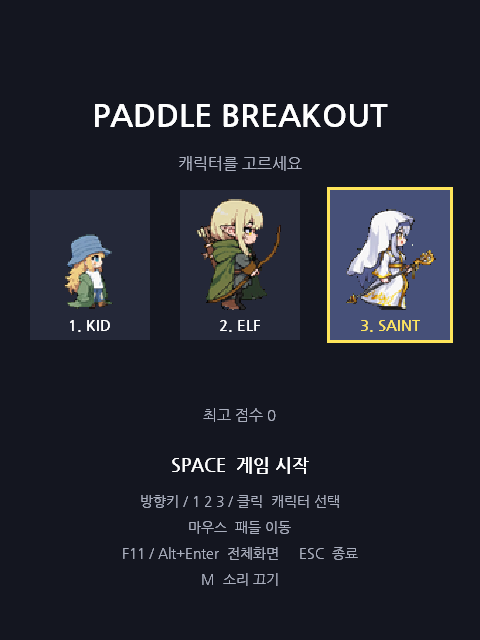
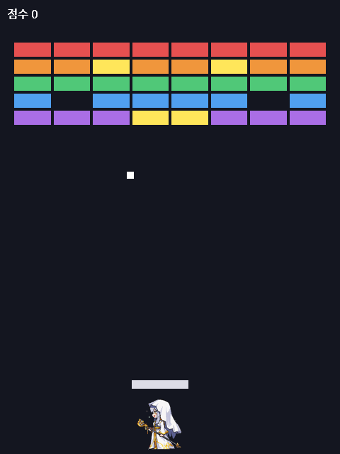

# Paddle Breakout

캐릭터를 골라 패들을 움직이며 벽돌을 깨는 2D 벽돌깨기 게임입니다.
C++과 Win32 GDI로 만들었습니다.

<p>
  
  
</p>

---

## 플레이 방법

1. 시작 화면에서 캐릭터를 고릅니다.
2. 스페이스바를 누르면 효과음과 함께 게임이 시작되고, 공이 아래에서 위로 날아갑니다.
3. 마우스를 좌우로 움직여 패들로 공을 받아냅니다. 캐릭터는 패들 아래에서 따라 걷습니다.
4. 벽돌을 모두 깨면 다음 스테이지로 넘어갑니다. 스테이지는 끝없이 이어집니다.
5. 공이 모두 아래로 빠지면 게임이 끝나고 시작 화면으로 돌아갑니다.

## 조작

| 키 | 동작 |
|---|---|
| 방향키 `←` `→` / 숫자 `1` `2` `3` / 카드 클릭 | 캐릭터 선택 |
| `Space` | 게임 시작 |
| 마우스 | 패들 이동 |
| `F11` / `Alt` + `Enter` | 전체화면 켜기·끄기 |
| `M` | 소리 켜기·끄기 |
| `Esc` | 전체화면 해제, 창 모드에서는 종료 |

## 규칙

- 위쪽과 좌우 벽은 닫혀 있고 아래만 열려 있습니다.
- 공은 벽과 패들에 부딪히면 들어온 각도 그대로 반사됩니다.
- 벽돌 하나를 깰 때마다 10점을 얻습니다.
- **노란 벽돌**을 깨면 그 자리에서 공이 하나 더 생깁니다.
- 공이 여러 개일 때는 마지막 공까지 빠져야 게임이 끝납니다.
- 게임을 시작할 때 판타지 배경 6종 중 하나가 무작위로 나오고, 스테이지가 바뀔 때마다 다른 배경으로 바뀝니다.
- 스테이지를 클리어하면 벽돌 배치가 바뀌고 공이 조금씩 빨라집니다. (배치 5종이 차례로 반복, 공 빠르기는 최대 1.6배)
- 스테이지가 시작되면 벽돌이 무작위 순서로 하나씩 톡톡 채워지고, 다 채워지면 공이 패들 위에서 출발합니다.
- 시작 화면에 이번 판의 스테이지와 점수, 최고 점수가 표시됩니다.
- 게임 시작, 벽돌 깨기, 스테이지 클리어, 게임 오버 때 각각 효과음이 나옵니다. 배경음악은 계속 반복됩니다.

## 캐릭터

| KID | ELF | SAINT |
|---|---|---|
| 모자를 쓴 작은 아이 | 활을 멘 엘프 | 지팡이를 든 성녀 |

캐릭터는 보여주기용이며 공과 부딪히지 않습니다. 어떤 캐릭터를 골라도 게임 규칙은 같습니다.

---

## 실행하기

Windows 전용입니다.

### 바로 실행

1. [Releases](https://github.com/dyd8115-max/PaddleGame/releases) 에서 최신 버전의 `PaddleBreakout` zip 파일을 받습니다.
2. 압축을 **모두** 풉니다. (압축 파일 안에서 바로 실행하면 그림과 소리를 찾지 못합니다)
3. `PaddleBreakout.exe`를 실행합니다.

처음 실행할 때 "Windows의 PC 보호" 창이 뜨면 **추가 정보 → 실행**을 누르세요.

### 직접 빌드 — Visual Studio

1. Visual Studio에서 **폴더 열기**로 이 저장소 폴더를 엽니다. (`CMakeLists.txt`를 자동으로 인식합니다)
2. 시작 항목으로 `PaddleBreakout.exe`를 고르고 실행합니다.

### 직접 빌드 — 명령줄

```
cmake -S . -B build
cmake --build build --config Release
```

빌드하면 `resources` 폴더의 그림과 소리 파일이 실행 파일 옆으로 함께 복사됩니다.
실행 파일만 따로 옮길 때는 `resources` 폴더의 파일 7개(`.bmp` 2개와 `.wav` 5개)를 같은 폴더에 두어야 합니다.
파일이 없어도 게임은 실행되며, 캐릭터는 사각형으로 그려지고 소리는 나지 않습니다.

---

## 폴더 구성

```
src/         게임 코드
  Geometry.h      벡터와 사각형 충돌
  GameObjects.h   공, 패들, 벽돌, 캐릭터
  Game.h/.cpp     게임 규칙과 상태 (Win32에 의존하지 않음)
  main.cpp        창, 입력, 그리기
  Audio.h/.cpp    배경음악과 효과음 재생 (별도 스레드)
resources/   실행에 필요한 그림과 소리
  characters.bmp  세 캐릭터의 걷기 애니메이션 (16프레임, 좌우 방향)
  backgrounds.bmp 배경 6종 (960x1280, 세로로 쌓음)
  bgm.wav         배경음악 (반복 재생)
  start.wav       게임 시작 효과음
  clear.wav       스테이지 클리어 효과음
  over.wav        게임 오버 효과음
  brick.wav       벽돌 깨는 효과음
assets/      캐릭터와 배경 원본 그림
tools/       그림과 음악을 만드는 스크립트
docs/        README 화면 사진
```

## 그림과 음악 다시 만들기

파이썬과 `Pillow`, `numpy`가 필요합니다.

```
python tools/build_sprites.py assets resources/characters.bmp
python tools/build_backgrounds.py assets/backgrounds resources/backgrounds.bmp
python tools/compose_music.py resources
```

- `build_sprites.py`: `assets`의 원본 시트 세 장을 GDI에서 바로 쓸 수 있는 BMP 한 장으로 합칩니다. 마젠타색이 투명색입니다.
- `build_backgrounds.py`: `assets/backgrounds`의 그림을 3:4로 자르고, 공과 벽돌이 잘 보이도록 어둡게 한 뒤 한 장으로 합칩니다.
- `compose_music.py`: 스크립트 안에 적힌 악보로 배경음악과 효과음 4종을 만듭니다. 음이나 빠르기를 고치면 새 음악이 만들어집니다.

---

## 그림과 소리 제작

- **캐릭터**: 로컬 PC에서 ComfyUI 워크플로를 직접 구성해 만들었습니다. 캐릭터 한 장을 마젠타 배경으로 그린 뒤, WAN 영상 생성 모델로 걷기 동작 영상을 만들고, 직접 만든 노드로 영상을 도트 프레임 16장의 스프라이트 시트로 변환했습니다.
- **배경**: 이미지 생성 AI로 도트 판타지 배경을 만든 뒤, `tools/build_backgrounds.py`로 게임 비율과 밝기에 맞게 가공했습니다.
- **음악과 효과음**: `tools/compose_music.py`에 악보를 코드로 적어 직접 작곡했습니다.
