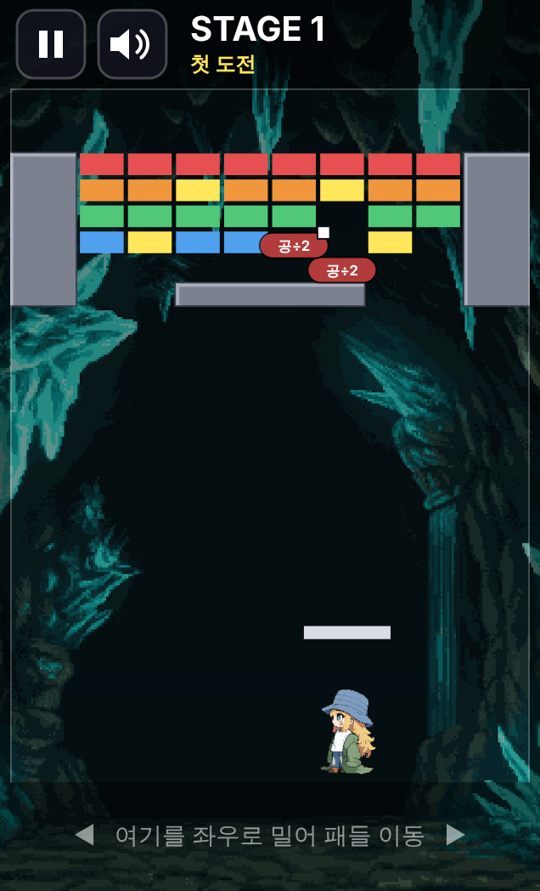
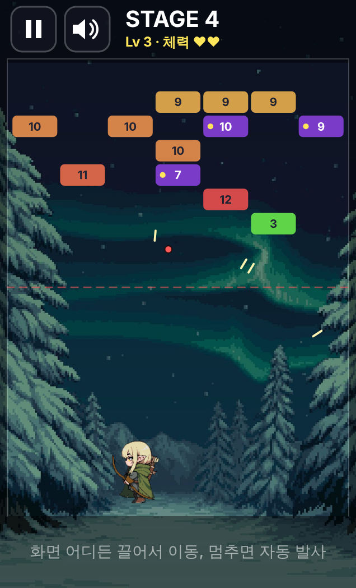
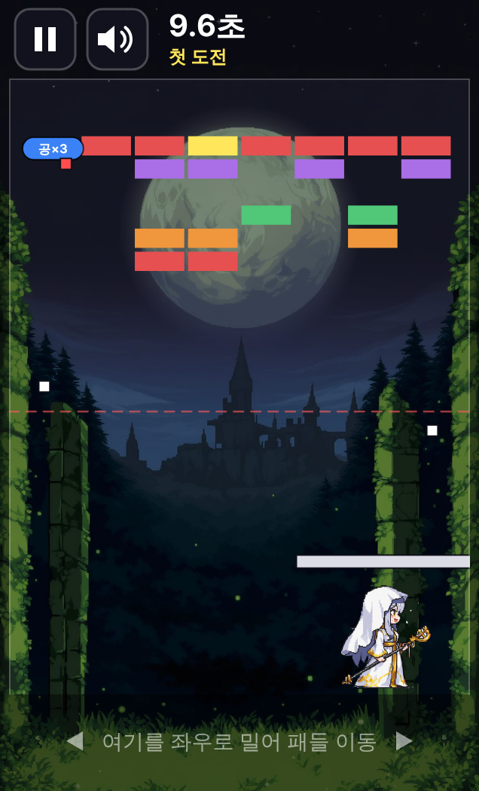

# 블록 브레이커 (모바일 버전)

캐릭터를 골라 패들로 벽돌을 깨는 세로형 모바일 게임입니다.
저장소 루트의 PC 버전과 같은 게임 규칙을 TypeScript와 캔버스로 옮기고, 앱인토스 SDK로 토스 미니앱에 올립니다.

<p>
  
  
  
</p>

## 실행하기

Node.js 22 이상이 필요합니다.

```
npm install
npm run dev
```

- PC 브라우저에서 터미널에 나온 주소(예: `http://localhost:5173`)를 엽니다. 오른쪽 아래 **AIT** 버튼으로 휴대폰 화면, 안전 영역, 토스 SDK 가짜 응답을 바꿔 볼 수 있습니다.
- 휴대폰으로 보려면 PC와 휴대폰을 같은 와이파이에 연결하고, 터미널에 나온 `Network:` 주소를 휴대폰 브라우저에서 엽니다.

## 토스에 올릴 파일 만들기

```
npm run build
```

`yonginu2022.ait` (appName 과 같은 이름) 가 만들어집니다. 앱인토스 콘솔에 올리고, QR로 토스 앱에서 테스트합니다.
`apps-in-toss.config.ts` 의 `appName` 은 콘솔에 등록한 이름과 같아야 합니다.

## 다른 형태로 만들기

**오프라인 HTML 한 파일**: 그림과 소리를 모두 넣은 파일 하나. 받아서 크롬으로 열면 인터넷 없이 실행됩니다.

```
npm run build
python tools/make_offline_html.py dist 블록브레이커_오프라인.html
```

**안드로이드 앱(APK)**: `android/` 폴더가 Capacitor 로 만든 안드로이드 프로젝트입니다.

```
npm run build
npx cap sync android     # 웹 빌드를 android/ 로 복사
npx cap open android     # Android Studio 로 열기 → Build > Build APK(s)
```

앱 아이콘과 시작 화면은 `python tools/make_android_res.py store android/app/src/main/res` 로 다시 만듭니다.

## 그림과 소리 다시 만들기

PC 버전의 원본 그림과 소리(저장소 루트의 `assets/`, `resources/`)를 웹용으로 바꿉니다. 파이썬과 `Pillow`, `numpy`, `ffmpeg`가 필요합니다.

```
python tools/build_web_assets.py .. public/assets
```

## 캐릭터마다 다른 게임

| 캐릭터 | 방식 | 특징 |
|---|---|---|
| KID | 패들로 받기, 가두리 맵 | 회색 우리 안에 벽돌이 빽빽해서 공이 들어가면 한꺼번에 깨짐. 위쪽 '공×2' 버튼으로 공 2배 (스테이지마다 한 번) |
| ELF | 스와이프 벽돌깨기 | 직접 조준해서 쏨. 벽돌 숫자만큼 맞혀야 깨지고, 벽돌이 바닥에 닿으면 끝 |
| SAINT | 패들로 받기, 빠른 공 | 회색 벽이 없고 공이 1.5배 빠름. 공을 다 놓쳐도 한 번 부활 |

## 조작

| 동작 | 휴대폰 | PC 브라우저 |
|---|---|---|
| 캐릭터 고르기 | 카드 누르기 | 카드 클릭, 방향키, 1 2 3 |
| 시작 | 시작하기 | Space |
| 패들 이동 (KID, SAINT) | 화면 아래쪽을 좌우로 밀기 | 마우스 |
| 조준하고 쏘기 (ELF) | 누른 채 아래로 당기고 놓기 | 마우스로 누른 채 당기고 놓기 |
| 공 2배 (KID) | 위쪽 공×2 버튼 | Space, S |
| 일시정지 | 왼쪽 위 Ⅱ, 안드로이드 뒤로가기 | P, Esc |
| 소리 켜기·끄기 | 스피커 버튼 | M |

## 규칙: KID, SAINT (패들로 받기)

- 위쪽과 좌우 벽은 닫혀 있고 아래만 열려 있습니다. 공은 들어온 각도 그대로 반사됩니다. 회색 벽은 깨지지 않습니다.
- 벽돌 하나에 10점. 벽돌을 깨면 30% 확률로 아이템이 떨어지고, 노란 벽돌은 항상 떨어집니다. 패들로 받으면 효과가 납니다.

  | 아이템 | 효과 |
  |---|---|
  | 공×2 | 지금 있는 공이 2배 |
  | 공×3 | 지금 있는 공이 3배 |
  | 공÷2 | 공이 절반 (최소 1개) |
  | 패들×1.5 | 패들 1.5배 (그 스테이지 동안) |
  | 패들÷3 | 패들 3분의 1 (그 스테이지 동안) |

- 늘어난 공은 색이 무작위입니다. 하양(기본 빠르기) 40%, 빨강(1.5배) 30%, 초록(0.5배) 30%. 공은 최대 30개까지.
- 벽돌을 모두 깨면 다음 스테이지. 공은 스테이지마다 1.3배씩 빨라집니다 (최대 4배).
- 2스테이지부터 악마가 패들 위에 올라타 공을 가립니다.
- 공이 한동안 벽돌을 못 깨고 같은 길만 오가면, 패들이나 벽에 맞을 때 방향이 조금 바뀝니다.

## 규칙: ELF (스와이프 벽돌깨기)

- 화면을 누른 채 아래로 당기면 반대쪽으로 조준선이 보입니다. 조준선은 두 번째로 부딪치는 곳까지 꺾여 보입니다. 손을 떼면 가진 공을 차례로 쏩니다.
- 벽돌의 숫자만큼 맞혀야 깨지고, 깨면 10점. 초록 +1 을 지나가면 다음 차례부터 공이 하나 늘어납니다.
- 공이 모두 바닥에 돌아오면 벽돌이 한 줄 내려오고 위에 새 줄이 생깁니다. 처음 돌아온 공 자리에서 다음에 쏩니다.
- 벽돌이 바닥선에 닿으면 끝. 공 빠르기는 라운드와 상관없이 같고, 한 차례가 8초를 넘기면 2배로 빨라집니다.

## 폴더 구성

```
src/
  game/        게임 규칙 (화면, 입력, 소리와 무관)
    geometry.ts  벡터와 사각형 충돌
    objects.ts   공, 패들, 벽돌, 캐릭터, 악마
    game.ts      게임 진행 (KID, SAINT: 패들로 받기)
    swipe.ts     엘프 모드 (스와이프 벽돌깨기)
    collide.ts   공 충돌, 같은 길만 도는 공 방향 바꾸기
  main.ts      시작점: 화면 크기, 입력, 게임 루프, 저장
  layout.ts    세로 휴대폰 화면 배치
  render.ts    캔버스 그리기
  audio.ts     배경음악과 효과음
  platform.ts  앱인토스 SDK 연결 (저장, 안전 영역, 뒤로가기, 리더보드)
  ui.ts        버튼 위치
public/assets/ 그림과 소리
store/         앱인토스 콘솔에 올리는 로고, 썸네일, 스크린샷
tools/
  build_web_assets.py  PC 버전 원본 그림·소리를 웹용으로 변환
  store_shots.py       콘솔용 세로 스크린샷 찍기
  store_art.py         콘솔용 로고, 썸네일, 공유 이미지 만들기
  make_web_preview.py  빌드 결과를 미리보기 페이지 하나로 묶기
  make_offline_html.py 인터넷 없이 열리는 HTML 한 파일 만들기
  make_android_res.py  안드로이드 앱 아이콘과 시작 화면 만들기
android/       안드로이드 앱 프로젝트 (Capacitor)
apps-in-toss.config.ts 앱인토스 설정
capacitor.config.ts    안드로이드 앱 설정
```
